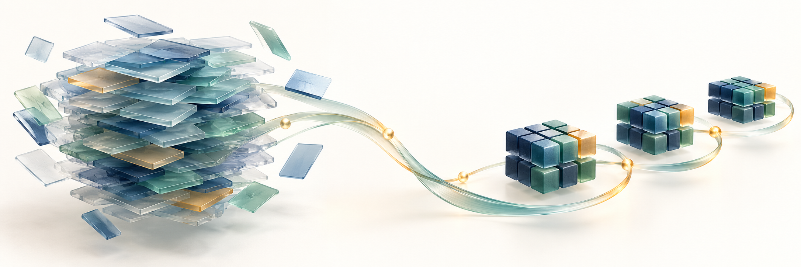
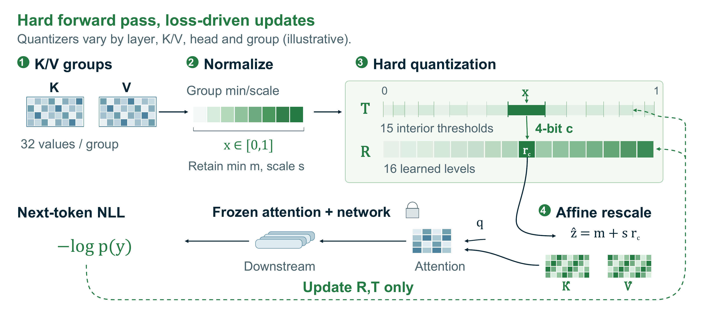
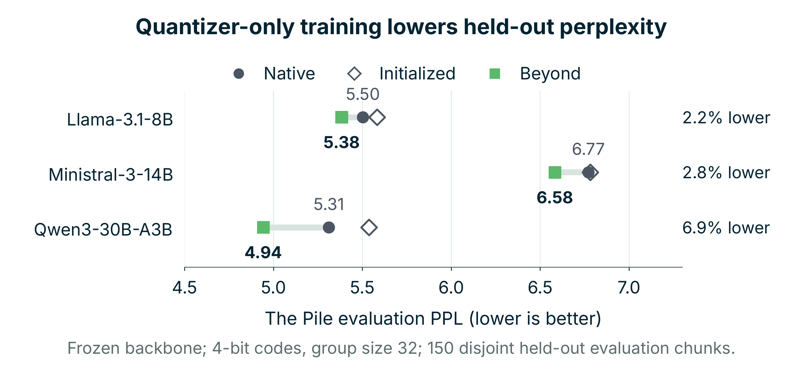
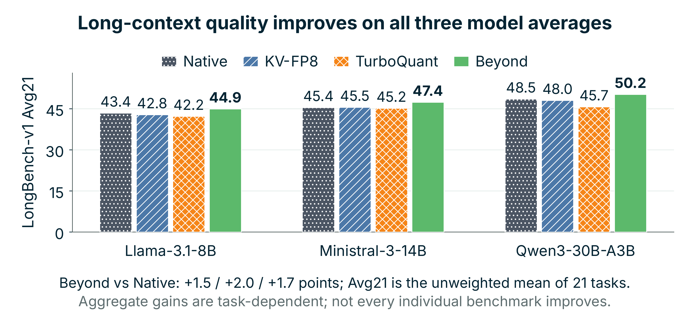
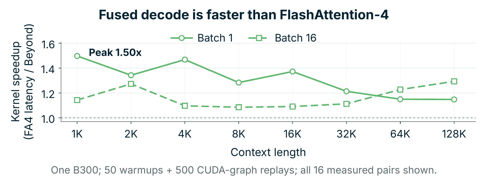
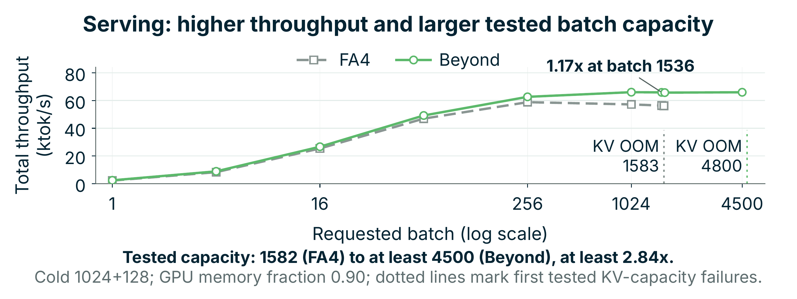

# Beyond

### Better-than-Full-Precision KV Caches via Learnable Non-Uniform Quantization as Implicit Regularization

**Yuhao Xie · Mingjie Lin** 
University of Central Florida · **EMNLP 2026 Main Conference**

[Project website](https://wsxhjnb1.github.io/Beyond-KV-Cache/) · [Paper](paper/Beyond.pdf) · [Final poster](docs/poster/EMNLP2026_Beyond_Poster.pdf) · [Installation & usage](USAGE.md)

**Compress the cache. Optimize what the model predicts.** Beyond freezes the
language model and learns non-uniform quantization levels and thresholds
directly from next-token loss. Its 4-bit caches improve quality across three
instruction-tuned models, while a fused decode kernel enables packed-cache
serving in vLLM.

| KV-payload compression | Lower perplexity | Peak speedups |
| :---: | :---: | :---: |
| **3.2×** | **2.2–6.9%** | **1.50× kernel · 1.17× end-to-end** |

## How it works

Hard assignments in the forward pass; straight-through input gradients and
boundary-localized threshold pseudo-gradients during training. Four-bit codes
with group size 32 require **5 effective bits per scalar**, including per-group
min/scale metadata: **3.2× KV-payload compression before page padding**, not
3.2× lower total GPU memory.

## Model quality

<table>
<tr>
<td width="50%"></td>
<td width="50%"></td>
</tr>
</table>

PPL: 150 disjoint held-out The Pile chunks. LongBench: unweighted average over
21 tasks, not a claim that every task improves. Quality uses **fake-QDQ** with
a floating-point cache; the packed-serving benchmarks below are separate.

## Packed-cache serving

<table>
<tr>
<td width="50%"></td>
<td width="50%"></td>
</tr>
</table>

Measured on **one NVIDIA B300**, using Llama-3.1-8B-Instruct. Kernel timing spans
1K–128K contexts; end-to-end throughput uses vLLM's official offline benchmark
with 1024-token prompts and 128-token generation.

Beyond supports tested batches of **at least 4500 versus 1582** for the
FlashAttention-4 path (**≥2.84×**). These are tested capacity points, not an exact
maximum. All speedups are configuration-specific. [Measurement details →](USAGE.md#measurement-scope)

## Get started

[Install](USAGE.md#requirements) · [Train](USAGE.md#training) · [Serve](USAGE.md#inference) · [Develop](USAGE.md#development) · [License](USAGE.md#license)
